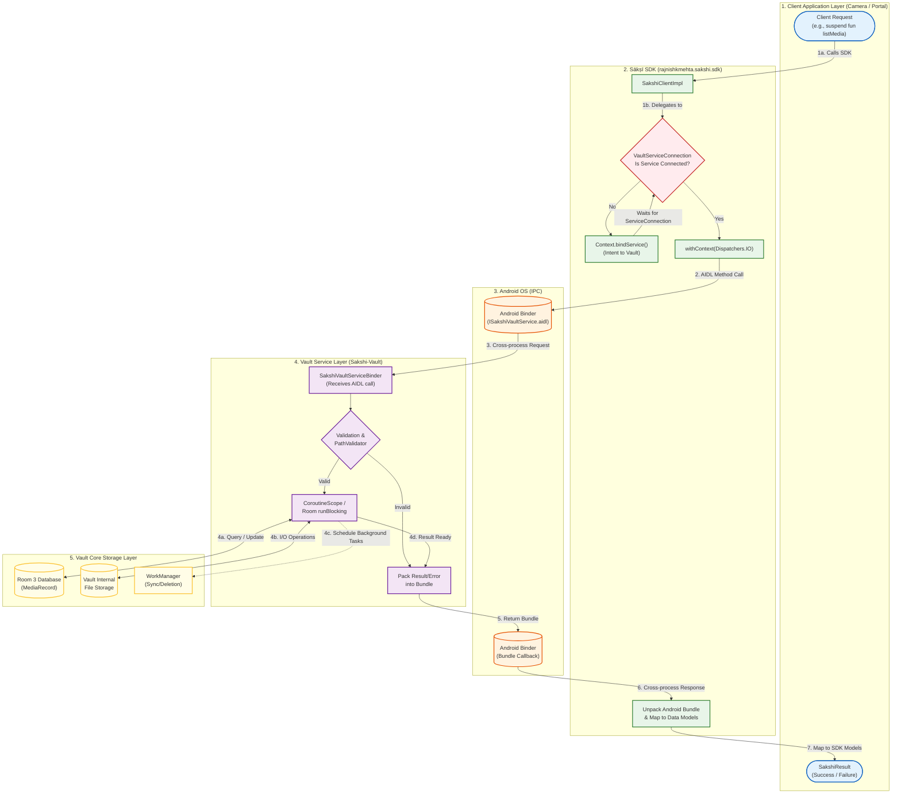

# Architecture Flow

This flowchart illustrates the detailed sequence of interactions between client applications, the Sākṣī SDK, and the Vault service during a typical operation. It outlines the responsibilities of each component and the specific Android and IPC mechanisms involved.

## Key Interactions

1. **Client Request**: The client application (like Portal or Camera) calls a high-level `suspend` function on `SakshiClient`.
2. **Connection Management**: The SDK's `VaultServiceConnection` checks if it's already bound to the Vault. If not, it uses Android's `bindService` to establish the connection before proceeding.
3. **Cross-Process Execution**: The SDK moves the actual AIDL execution to the `Dispatchers.IO` thread to avoid blocking the client's main thread during the IPC transaction.
4. **Vault Processing**: Once `SakshiVaultServiceBinder` receives the request inside the Vault process, it validates the inputs. It then performs the necessary operations using Room (database) and local file storage, either synchronously (`runBlocking` for fast database reads) or asynchronously (`CoroutineScope` for I/O).
5. **Response Translation**: The result from the Vault is packed into an Android `Bundle` and sent back over the Binder. The SDK unpacks this, mapping it into a clean `SakshiResult.Success` or `SakshiResult.Failure` for the client to consume natively.
