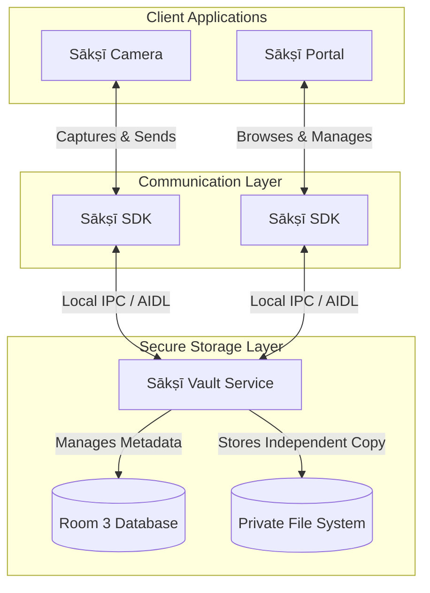

# Ecosystem Overview

The Sākṣī ecosystem is built on a modular architecture. Rather than relying on a single, monolithic application that could become a single point of failure or compromise, Sākṣī separates its responsibilities across distinct components.

This approach minimizes the attack surface of the storage layer and ensures your media is handled independently from the interfaces used to capture or view it.

## Component Responsibilities

1. **[Sākṣī SDK](https://github.com/RajnishKMehta/Sakshi-SDK)**: The communication bridge. This headless library handles all Inter-Process Communication (IPC) via Android Binder (AIDL), allowing the user-facing apps to securely send requests and stream data to the Vault.
2. **[Sākṣī Vault](https://github.com/RajnishKMehta/Sakshi-Vault)**: The secure storage engine. Operating entirely in the background without a UI, Vault receives incoming media via the SDK and safely stores it in its own private, isolated app container. It manages synchronization states, delayed media deletion processes, and file metadata.
3. **[Sākṣī Camera](https://github.com/RajnishKMehta/Sakshi-Camera)**: The capture interface. It handles hardware interactions (camera lenses, microphones), writes the media files locally, and orchestrates sending those files to the Vault using the SDK.
4. **[Sākṣī Portal](https://github.com/RajnishKMehta/Sakshi-Portal)**: The viewing interface. It communicates with the Vault via the SDK to fetch metadata, stream stored media for viewing, and handle secure exports back to your public gallery if requested.

## Media Flow Architecture

The following diagram illustrates how media and data flow between the independent Sākṣī components strictly locally, without relying on internet connections.

## Media Synchronization Strategies

How Sākṣī Camera syncs media to Sākṣī Vault depends heavily on the format being recorded. Sākṣī supports two distinct video recording pipelines, which dictate how the preservation occurs.

### Fragmented MP4 (fMP4) - Incremental Synchronization

Fragmented MP4 (fMP4) is the default and recommended video format in Sākṣī Camera.

Because fMP4 writes video data in small, distinct fragments, Sākṣī Camera can read these fragments and send them to the Vault *while the recording is still happening*.
* **Benefits**: This is highly interruption-resilient (crash-safe). If the phone is suddenly shut off, destroyed, or the app is force-closed, the fragments that have already been written and incrementally transferred to the Vault are preserved.
* **Flow**: Camera records an fMP4 fragment $\rightarrow$ Camera instantly streams fragment via SDK to Vault $\rightarrow$ Vault appends fragment to its independent copy $\rightarrow$ Camera records next fragment.

### Standard MP4 - Post-Recording Synchronization

Standard MP4 files require the entire recording to be completed and finalized before the file becomes playable or readable.
* **Benefits**: Standard MP4 is universally compatible with nearly all legacy hardware and software.
* **Flow**: Camera begins recording $\rightarrow$ User stops recording $\rightarrow$ MP4 file is finalized $\rightarrow$ Camera uses SDK to transfer the complete file to the Vault in one copy operation.
* **Limitation**: Because standard MP4 cannot be synced incrementally, it is not crash-safe. If the recording is interrupted before completion, the file is corrupted, and nothing is successfully preserved in the Vault. Using this mode requires acknowledging this security trade-off.

Photos (JPEGs) follow the standard post-capture transfer flow, as they are taken instantaneously.
