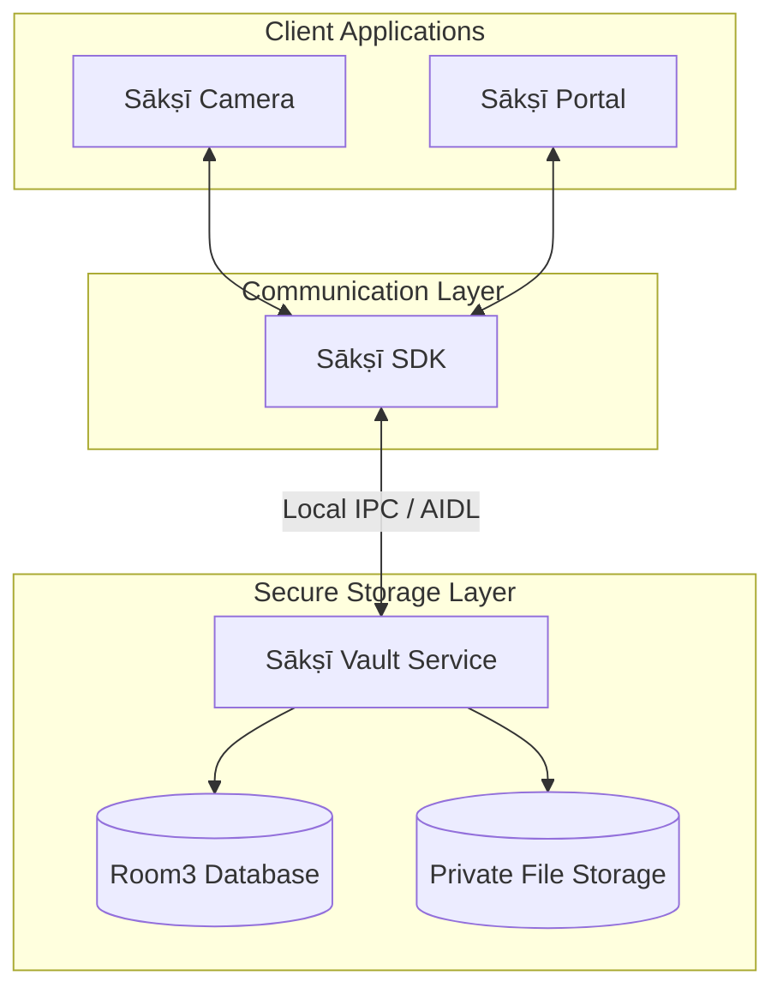

# Ecosystem Overview

The Sākṣī ecosystem is designed as a set of separate, modular applications, each dedicated to a specific task. By separating the tools used to capture, view, and store your media, these applications work together seamlessly to provide a secure and flexible experience.

## Component Responsibilities

1. **[Sākṣī SDK](https://github.com/RajnishKMehta/Sakshi-SDK)**: The communication bridge. This headless library handles all Inter-Process Communication (IPC) via Android Binder (AIDL), allowing the user-facing apps to securely send requests and stream data to the Vault.
2. **[Sākṣī Vault](https://github.com/RajnishKMehta/Sakshi-Vault)**: The secure storage engine. Operating entirely in the background without a UI, Vault receives incoming media via the SDK and safely stores it in its own private app container. *(Note: While stored in a private container, this does not currently prevent other installed apps from accessing the media because the exported service and provider lack strict caller access controls).* It manages synchronization states, delayed media deletion processes, and file metadata.
3. **[Sākṣī Camera](https://github.com/RajnishKMehta/Sakshi-Camera)**: The capture interface. It handles hardware interactions (camera lenses, microphones), writes the media files locally, and orchestrates sending those files to the Vault using the SDK.
4. **[Sākṣī Portal](https://github.com/RajnishKMehta/Sakshi-Portal)**: The viewing interface. It communicates with the Vault via the SDK to fetch metadata, stream stored media for viewing, and handle secure exports back to your public gallery if requested.
5. **Sākṣī Voice Recorder (Planned)**: A future Sākṣī application dedicated to recording audio instead of photos and videos. It is planned to integrate with the same ecosystem and Vault workflow. This component is not currently available.

## Media Flow Architecture

The following diagram illustrates how media and data flow between the independent Sākṣī components strictly locally, without relying on internet connections.

