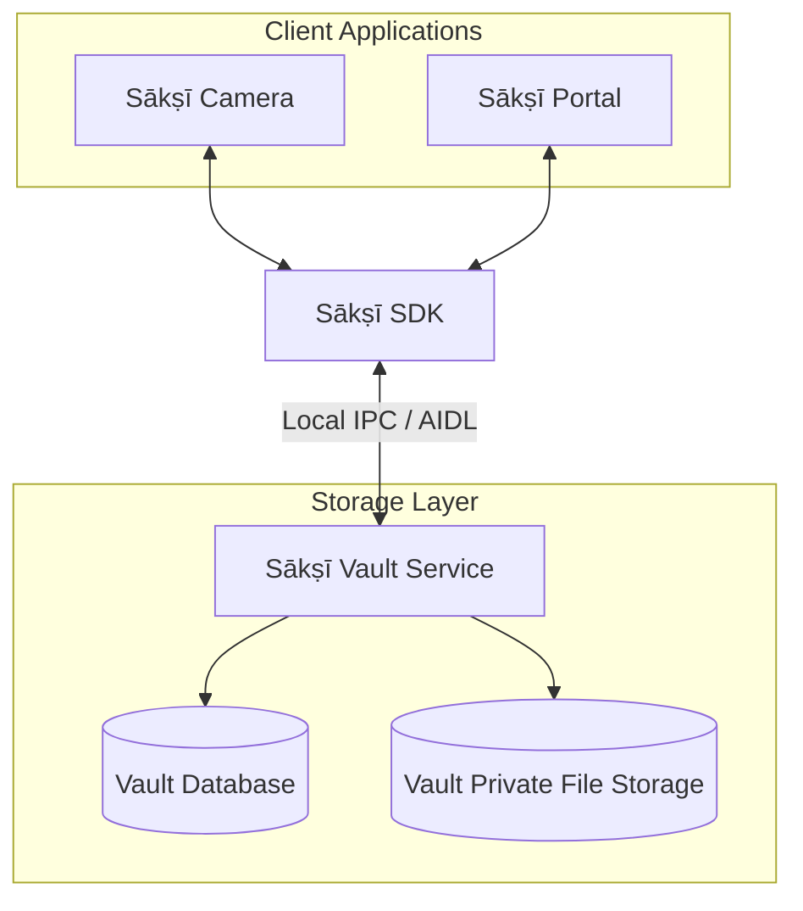

# Ecosystem Overview

The Sākṣī ecosystem separates capture, communication, storage, and media management into independent components. This modular design lets each application focus on one responsibility while communicating locally with the Vault.

## Component Responsibilities

1. **[Sākṣī Camera](https://github.com/RajnishKMehta/Sakshi-Camera)** handles camera and microphone interactions, captures photos and videos, and sends supported media to Vault through the SDK.
2. **[Sākṣī Portal](https://github.com/RajnishKMehta/Sakshi-Portal)** provides the interface for browsing, viewing, managing, and exporting media stored in Vault.
3. **[Sākṣī SDK](https://github.com/RajnishKMehta/Sakshi-SDK)** provides the client-side APIs and Android IPC integration used by Camera and Portal to communicate with Vault.
4. **[Sākṣī Vault](https://github.com/RajnishKMehta/Sakshi-Vault)** is the background storage service. It receives media, stores it in its app-private storage, and maintains file and synchronization metadata.
5. **Sākṣī Voice Recorder (planned)** is a future audio-recording application intended to use the same Vault workflow. It is not currently available.

## Media Flow Architecture

The following diagram shows the local data flow between the Sākṣī components. Media transfer and service communication are designed to work without an internet connection.

## Important Security Boundary

Vault stores media in its own application storage, but this alone should not be interpreted as protection against every application-level or device-level attack. Actual access control depends on the exported service and provider configuration, Android permissions, and the device's security state. Do not treat Sākṣī as a substitute for secure device configuration or an independent off-device backup.

## Continue Reading

- **[User Guide](../user-guide/index.md):** learn how to install and use the Sākṣī applications.
- **Developer Guide:** coming soon. SDK integration and architecture documentation will be added here.
